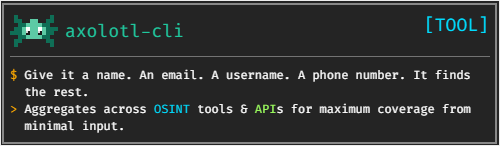
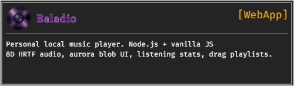

<div align="center">

[](https://git.io/typing-svg)

</div>

```bash
$ whoami
rxdwan \ Ridwan. I build stuff. Mostly Python.
Sometimes it talks back.

$ ls ~/projects
axolotl-cli/    maria/    AdvanceInvisibility/    Baladio/    RealWorld/

$ cat ~/interests.txt
- Programming
- Cyber Security
- Local LLMs & AI agents
- OSINT tooling
- Automation systems
```

<br>

## `~/projects`


<br>


<br>

## `~/stack`

<div align="center">


</div>

<br>

## `~/stats`

<div align="center">

[](https://github.com/rxdwan)
&nbsp;
[](https://github.com/rxdwan)

<br>

[](https://github.com/rxdwan)

</div>

<br>

```bash
$ echo "currently running..."
→ axolotl-cli   [building]
→ maria         [debugging tool calls]
→ ???           [no name yet]

$ echo "find me"
→ github.com/rxdwan
```

<br>

<div align="center">


</div>